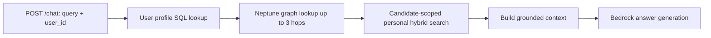

# RDS + Neptune RAG PoC

A retrieval-augmented generation prototype for user profiles, family relationships, appointments, and care knowledge. Structured data is stored in PostgreSQL (RDS or Supabase), relationships are stored in Amazon Neptune, and document chunks use PostgreSQL with pgvector and full-text search.

## Workflow



- PostgreSQL search looks up only the current user's `user_profiles` row. Graph search starts from the user ID, finds family and appointment nodes up to three hops away, and looks up those records in PostgreSQL.
- Graph search returns owned `personal_chunks` IDs without loading their content. Hybrid search loads only those candidates, then combines pgvector cosine similarity with PostgreSQL full-text search. `doc_chunks` remains a shared health-knowledge search source.
- Hybrid search combines pgvector similarity search with PostgreSQL full-text search. Neither `doc_chunks` nor `personal_chunks` stores a `user_id`; optional ownership is represented by Neptune `owns` edges.
- SQL, Graph, and Hybrid chunks are combined into grounded context and sent to Bedrock to generate an answer with sources.

## Project files

| File | Purpose |
| --- | --- |
| `main.py` | FastAPI `/chat` endpoint with JSON and `stream=true` responses |
| `question_service.py` | Service entry point for the LangGraph workflow |
| `rag_graph.py` | Defines the LangGraph nodes, state, conditional routes, and workflow edges |
| `intent_router.py` | Classifies questions as personal, calendar/reminder, health, or general |
| `postgreSQL_search.py` | Looks up PostgreSQL records by table and primary key IDs |
| `graph_search.py` | Queries user-related Neptune nodes and hydrates family/appointment records from PostgreSQL |
| `hybrid_search.py` | Runs vector and full-text search over shared document chunks or graph-selected personal chunks |
| `calendar_reminder.py` | Google Calendar OAuth routes and event operations |
| `external_search.py` | Searches external health sources such as MedlinePlus |
| `chunk_builder.py` | Shared chunk formatting for SQL, Graph, and external results |
| `grounded_context_new.py` | Combines chunks into grounded context |
| `answer_generator.py` | Uses Bedrock to generate answers and sources |
| `test/insert_*.py` | Creates/inserts sample user, family, and appointment data |
| `test/reset_doc_chunks.py` | Embeds the selected Markdown file and rebuilds `doc_chunks` or `personal_chunks` |
| `test/test_external_search.py` | Queries the external health source and prints topic results |
| `test/test_*.py` | Manually runs retrieval and answer-generation flows for debugging |

## Setup

Python 3.12 or newer is recommended.

```bash
python3 -m venv .venv
source .venv/bin/activate
pip install -r requirements.txt
```

Create a `.env` file in the project root. At minimum, configure the database and Neptune:

```dotenv
DATABASE_BACKEND=rds
RDS_HOST=<rds-host>
RDS_PORT=5432
RDS_DB_NAME=<database-name>
RDS_USER=<database-user>
RDS_PASSWORD=<database-password>

NEPTUNE_ENDPOINT=https://localhost:8182
AWS_REGION=us-east-2
BEDROCK_REGION=us-east-2
LLM_PROVIDER=bedrock
BEDROCK_EMBEDDING_MODEL_ID=us.cohere.embed-v4:0
BEDROCK_EMBEDDING_DIMENSION=1536
GOOGLE_CLIENT_ID=<google-oauth-client-id>
GOOGLE_CLIENT_SECRET=<google-oauth-client-secret>
GOOGLE_REDIRECT_URI=http://localhost:8000/auth/callback
```

You can use `RDS_DATABASE_URL` instead of `RDS_HOST`, `RDS_PORT`, `RDS_DB_NAME`, `RDS_USER`, and `RDS_PASSWORD`. Do not commit credentials; `.gitignore` excludes `.env`.

Bedrock text generation uses the AWS default credential chain, such as an AWS CLI profile or environment credentials. The configured AWS identity must be allowed to call the selected Bedrock models. Override model IDs with:

```dotenv
BEDROCK_EXTRACTOR_MODEL_ID=<bedrock-model-id>
BEDROCK_ANSWER_MODEL_ID=<bedrock-model-id>
```

Router, query extraction, answer generation, and embeddings currently use Amazon Bedrock. The provider selection remains centralized in `config.py` so another backend can be added later.

### Neptune SSH tunnel

If Neptune is accessed through a bastion host, keep an SSH tunnel open in another terminal. Replace the placeholders with your key path and host addresses:

```bash
ssh -i /path/to/neptune.pem -N \
  -L 8182:<neptune-cluster-endpoint>:8182 \
  ec2-user@<bastion-public-ip>
```

The application connects to the tunnel at `https://localhost:8182` by default. The current local-tunnel configuration skips TLS certificate verification.

## Initialize database data

Create user profiles first so the sample user IDs are available to the structured search and graph relationships:

```bash
python test/insert_user_profile.py
python test/insert_family_relationships.py
python test/insert_appointment.py
```

Edit the `USER_PROFILES`, `FAMILY_RELATIONSHIPS`, and `APPOINTMENTS` variables near the top of the scripts to change the sample IDs and data. The scripts write to PostgreSQL; the family and appointment scripts also create their corresponding Neptune relationships.

### Create the chunk tables

The rebuild script can create the selected table if it does not exist. The example below shows the expected schema; enable pgvector first. The script infers the vector dimension from the embeddings it generates.

```sql
CREATE EXTENSION IF NOT EXISTS vector;

CREATE TABLE IF NOT EXISTS doc_chunks (
    id TEXT PRIMARY KEY,
    category TEXT NOT NULL,
    section TEXT NOT NULL,
    content TEXT NOT NULL,
    embedding vector(1536) NOT NULL
);

CREATE TABLE IF NOT EXISTS personal_chunks (
    id TEXT PRIMARY KEY,
    category TEXT NOT NULL,
    section TEXT NOT NULL,
    content TEXT NOT NULL,
    embedding vector(1536) NOT NULL
);
```

Then run the embedding/rebuild script:

```bash
python test/reset_doc_chunks.py
```

In `test/reset_doc_chunks.py`, set `CHUNK_TABLE` to the destination and `MARKDOWN_FILE` to the Markdown file to embed. The script creates the selected table if needed, then truncates and rebuilds it without a `user_id` column. If `DOC_OWNER_USER_ID` is set, the script records ownership in Neptune as `User -[relationship: owns]-> Chunk`.

## Run the service

```bash
uvicorn main:app --reload
```

The Google Calendar demo is served at `http://localhost:8000/test/googleCalendar/index.html`. Its OAuth client needs that exact redirect URI registered in Google Cloud. The app supports viewing, creating, and deleting events after authorization. Keep OAuth values in `.env` (or the ignored local `test/googleCalendar/.env.json`); never commit secrets. Install the Google Calendar dependencies with `python -m pip install -r requirements.txt`.

The API endpoint is `http://127.0.0.1:8000/chat`. The request body accepts `query` and `user_id`; `user_id` defaults to `USER-001`:

```bash
curl -N -X POST 'http://127.0.0.1:8000/chat?stream=true' \
  -H 'Content-Type: application/json' \
  -d '{"query":"show me my family and appointments","user_id":"USER-001"}'
```

Omit `?stream=true` to receive a JSON response. This PoC accepts `user_id` directly from the request body. In an application with authentication, derive the user ID from the verified login identity instead.

## Manual debug scripts

These scripts call the configured database, Neptune instance, or language models; they are not isolated unit tests. Configure `.env`, AWS credentials, and the SSH tunnel before running them:

```bash
python test/test_postgreSQL_search.py
python test/test_graph_search.py
python test/test_hybrid_search.py
python test/test_external_search.py
python test/test_grounded_context.py
python test/test_answer_generator.py
```

Set `USER_ID` near the top of `test_postgreSQL_search.py`, `test_graph_search.py`, `test_grounded_context.py`, and `test_answer_generator.py` to switch the test user. `test_hybrid_search.py` accepts a `QUERY` and `CANDIDATE_CHUNK_IDS` list for personal chunk retrieval.
