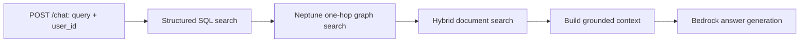

# RDS + Neptune RAG PoC

一个面向用户个人资料、家庭关系、预约和照护知识的 RAG 原型。结构化数据保存在 PostgreSQL（RDS/Supabase），关系保存在 Amazon Neptune，文档 chunks 使用 PostgreSQL + pgvector 和全文搜索。

## 工作流程



- Structured SQL search 只查询请求用户自己的 `user_profiles`、`family_relationships` 和 `appointments` 数据。
- Graph search 从 SQL chunks 的实体 ID 出发，在 Neptune 查找一跳关系，再按实体类型分组回查 PostgreSQL。
- Hybrid search 同时使用 pgvector 向量检索和 PostgreSQL 全文检索，并按 `user_id` 隔离 chunks。
- SQL、Graph、Hybrid chunks 会合并成 grounded context，再交给 Bedrock 生成带来源的回答。

## 项目文件

| 文件 | 用途 |
| --- | --- |
| `main.py` | FastAPI `/chat` 接口，支持普通 JSON 和 `stream=true` 流式进度 |
| `question_service.py` | 编排 SQL、Graph、Hybrid、context 和回答生成 |
| `structured_query.py` | Bedrock 查询条件提取、参数化 SQL 生成与执行 |
| `graph_search.py` | Neptune 一跳查询、实体分组和 PostgreSQL 回查 |
| `hybrid_search.py` | `doc_chunks` 向量 + 全文混合检索，并按用户过滤 |
| `chunk_builder.py` | SQL 和 Graph 共用的 chunk 格式化逻辑 |
| `grounded_context_new.py` | 将多路 chunks 拼成 grounded context |
| `answer_generator.py` | 调用 Bedrock 生成答案和来源 |
| `test/insert_*.py` | 创建/插入用户、家庭和预约样例数据 |
| `test/reset_doc_chunks.py` | 对 `data/data.md` 重新 embedding 并重建 `doc_chunks` |
| `test/test_*.py` | 手动运行各检索环节的调试脚本 |

## 环境准备

建议使用 Python 3.12 或更新版本。

```bash
python3 -m venv .venv
source .venv/bin/activate
pip install -r requirements.txt
```

在项目根目录创建 `.env`。至少配置数据库和 Neptune：

```dotenv
DATABASE_BACKEND=rds
RDS_HOST=<rds-host>
RDS_PORT=5432
RDS_DB_NAME=<database-name>
RDS_USER=<database-user>
RDS_PASSWORD=<database-password>

NEPTUNE_ENDPOINT=https://localhost:8182
AWS_REGION=us-east-2
BEDROCK_REGION=us-east-2
LLM_PROVIDER=bedrock
BEDROCK_EMBEDDING_MODEL_ID=us.cohere.embed-v4:0
BEDROCK_EMBEDDING_DIMENSION=1536
```

也可以用 `RDS_DATABASE_URL` 代替 `RDS_HOST`、`RDS_PORT`、`RDS_DB_NAME`、`RDS_USER` 和 `RDS_PASSWORD`。配置里的凭据不要提交到 Git；`.gitignore` 已忽略 `.env`。

Bedrock 文本生成使用 AWS 默认凭证链（例如已配置的 AWS CLI profile 或环境凭证），需要有权调用配置的 Bedrock 模型。模型可通过以下变量覆盖：

```dotenv
BEDROCK_EXTRACTOR_MODEL_ID=<bedrock-model-id>
BEDROCK_ANSWER_MODEL_ID=<bedrock-model-id>
```

`LLM_PROVIDER` 用于选择 embedding provider。当前也支持 Gemini embedding；使用时需设置 `LLM_PROVIDER=gemini` 和 `GEMINI_API_KEY`。查询抽取和答案生成使用 Bedrock。

### Neptune SSH 隧道

如果通过 bastion 主机访问 Neptune，在另一个 terminal 窗口保持 SSH 隧道运行，并将下列占位符替换为自己的路径和地址：

```bash
ssh -i /path/to/neptune.pem -N \
  -L 8182:<neptune-cluster-endpoint>:8182 \
  ec2-user@<bastion-public-ip>
```

应用默认通过 `https://localhost:8182` 连接隧道。项目当前为本地隧道配置了未验证 TLS 证书的连接方式。

## 数据库初始化

先创建用户，因为家庭和预约表的 `user_id` 外键引用 `user_profiles(user_id)`：

```bash
python test/insert_user_profile.py
python test/insert_family_relationships.py
python test/insert_appointment.py
```

样例 ID 和内容可分别在这些脚本顶部的 `USER_PROFILES`、`FAMILY_RELATIONSHIPS`、`APPOINTMENTS` 变量中修改。插入脚本会写入 PostgreSQL；家庭和预约脚本也会在 Neptune 创建对应关系。

### 创建 `doc_chunks` 表

`doc_chunks` 需要先存在。首次建表时，确保已安装 pgvector，并让 vector 维度与 embedding 模型配置一致（默认 1536）：

```sql
CREATE EXTENSION IF NOT EXISTS vector;

CREATE TABLE IF NOT EXISTS doc_chunks (
    id TEXT PRIMARY KEY,
    category TEXT NOT NULL,
    section TEXT NOT NULL,
    content TEXT NOT NULL,
    embedding vector(1536) NOT NULL
);
```

然后运行 embedding / 重建脚本：

```bash
python test/reset_doc_chunks.py
```

该脚本会清空并重建整张 `doc_chunks` 表的内容；会添加 `user_id` 外键列，并把当前 `data/data.md` 的全部 chunks 归给 `DOC_OWNER_USER_ID`（目前为 `USER-001`）。如需更换归属用户，修改 `test/reset_doc_chunks.py` 中的变量后再运行。请先确认对应用户已存在于 `user_profiles`。

## 启动服务

```bash
uvicorn main:app --reload
```

API 地址：`http://127.0.0.1:8000/chat`。请求体包含 `query` 和 `user_id`；`user_id` 默认是 `USER-001`：

```bash
curl -N -X POST 'http://127.0.0.1:8000/chat?stream=true' \
  -H 'Content-Type: application/json' \
  -d '{"query":"show me my family and appointments","user_id":"USER-001"}'
```

省略 `?stream=true` 会返回 JSON。此 PoC 直接接受请求体中的 `user_id`；接入登录系统后，应从已验证的登录身份取得用户 ID。

## 手动调试脚本

这些是调用真实数据库、Neptune 或模型的手动脚本，不是隔离的单元测试。运行前确认 `.env`、AWS 凭证和 SSH 隧道均已准备好：

```bash
python test/test_structured_query.py
python test/test_graph_search.py
python test/test_hybrid_search.py
python test/test_grounded_context.py
python test/test_answer_generator.py
```

各检索测试脚本可通过文件顶部的 `USER_ID` 变量切换测试用户。
